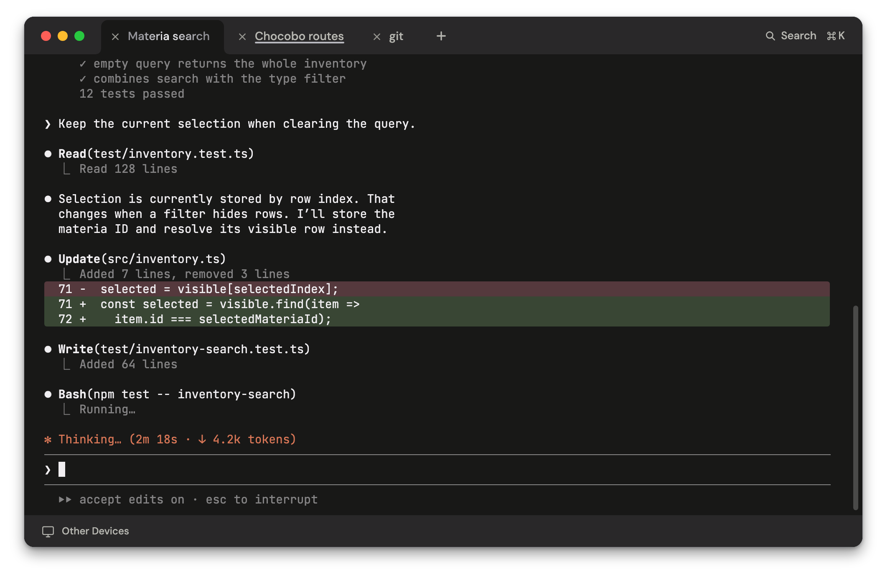

<p align="center">
  
</p>
<h1 align="center">Xpromptvs</h1>
<p align="center">A terminal for macOS, with remote access.</p>

<p align="center">
  
</p>

Terminal tabs, tmux integration, smooth scrolling, and truecolor. You can also share Mac windows, desktops, and iOS simulators.

Pairing uses the hosted Xpromptvs service. This repository contains the app.

## Build

Requires Apple Silicon, macOS 26+, Xcode, Node.js 20.19+, Bazelisk, and CMake.

```sh
git submodule update --init third_party/libaom third_party/libopus
npm --prefix protocol ci
npm --prefix web ci
npm --prefix desktop ci
npm --prefix desktop run build:check
```

The app is built at `desktop/release-check/Xpromptvs Development.app`. See the [build guide](docs/building.md) for signing and enrollment.

[Architecture](docs/architecture.md) · [Testing](docs/testing.md)

[MIT](LICENSE) © Spectral Gardens. [Third-party licenses](THIRD_PARTY_NOTICES.md) · [Branding](BRANDING.md)
